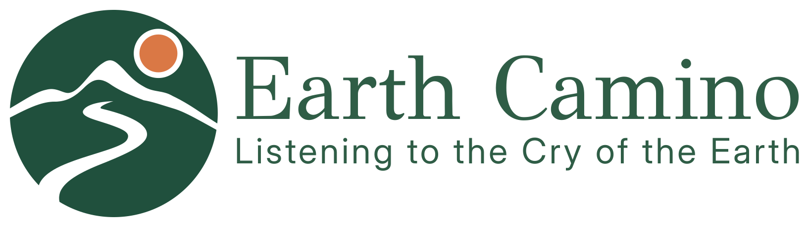

  <picture>
    <source media="(prefers-color-scheme: dark)" srcset="logo/logo-dark.svg">
    
  </picture>

# Earth Camino

Website for Cecily Maher's Earth Camino: a six-day, 220 km walk from Waterford City to Dublin along the River Barrow and the Grand Canal, 9 to 14 November 2026, ending at the Climate March.

Live at [acoci86.github.io/earth-camino](https://acoci86.github.io/earth-camino/).

## What's here

- `index.html`: the page
- `css/style.css`: styling
- `js/map.js`: the interactive route map, day buttons and elevation strip (Leaflet)
- `js/page.js`: the hand-drawn touches (rough.js, Rough Notation), the day cards and the scroll-in effects
- `js/route.js`: route line and elevation data
- `img/`, `logo/`: photos, icons and logos
- `fonts/`: the fonts, served from the site (SIL Open Font License)
- `vendor/`: Leaflet, rough.js and Rough Notation, served from the site so no outside service can block them

It's a static site with no build step: open `index.html` in a browser, or serve the folder with any static host.

## Credits

- Photos: Wikimedia Commons and iNaturalist contributors, credited and licensed in each caption.
- Map tiles: Esri, OpenTopoMap, Waymarked Trails and © OpenStreetMap contributors.
- Route line: OpenStreetMap walking directions (approximate). Elevation: Open-Meteo (Copernicus DEM).
- Libraries: [Leaflet](https://leafletjs.com), [rough.js](https://roughjs.com), [Rough Notation](https://roughnotation.com).

Website by [Alessio Coci](https://acoci.dev/).
